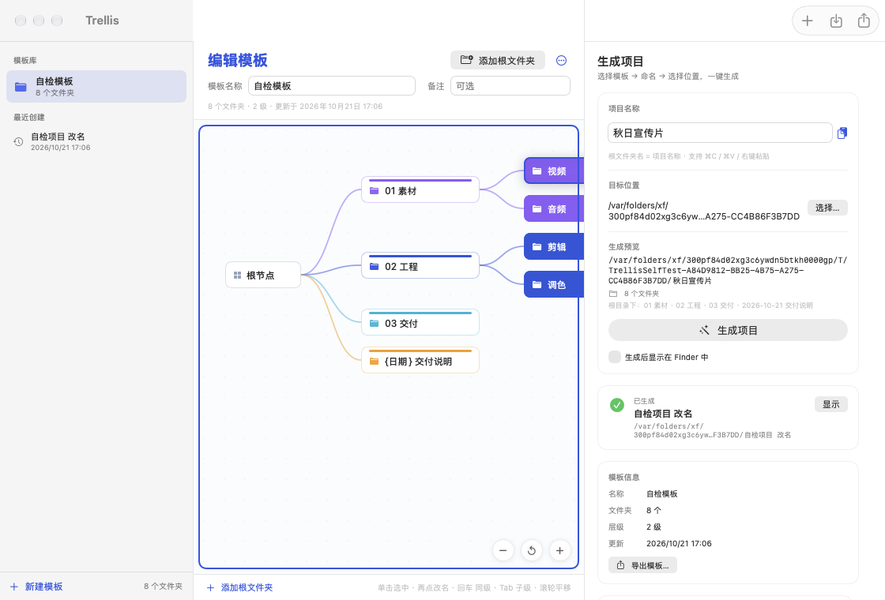

# Trellis · 目录模板

**Trellis**（中文名：目录模板）是一个原生 macOS 小工具，把常用的**项目目录结构**保存成模板，之后选一个位置、给项目起个名字，就能一键生成整套项目文件夹。



> 为影视飓风 Gate 的「目录模板」场景单独重做：保留蓝色主色与树形结构，但换成原生 AppKit/SwiftUI，输入框完整支持复制粘贴。

## 两个平台

- **macOS**：本仓库根目录的 Xcode 工程（SwiftUI），构建方式见下方
- **Windows 10 / 11（x64）**：Electron 版本，源码在 [`windows/`](windows/README.md)，安装包用 NSIS 生成

---

## 功能

### 模板库
- 新建、重命名、复制、删除模板（删除模板不会动磁盘上已经生成的项目）
- 模板导出为 JSON / 从 JSON 导入，方便在同事之间共享（导入时自动改名，不会覆盖）
- 本地持久化：`~/Library/Application Support/DirTemplate/library.json`

### 思维导图式模板编辑（Gate 风格）
- 横向思维导图：根节点在左，按层级向右展开，每个顶层分支一种颜色
- 顶层节点是白底＋色条卡片，子级是分支色实心卡片，贝塞尔曲线连接
- 画布支持滚轮平移、双指缩放、右下角 − / 重置 / + 按钮
- 画布是独立的焦点区域：点击画布（或其中任意节点）后，画布四周出现**重点色边框**表示已激活，此时 Tab / 回车才作用于导图；点击侧栏、顶部输入框或右侧面板，边框消失，Tab 恢复系统默认的焦点切换
- 单击立即选中；**在已选中的节点上再点一次，直接进入改名**（不再等双击判定）
- 节点悬停出现「＋」，右键可新建子级、重命名、复制、上移 / 下移、删除
- **键盘连续录入**（参考 Gate 的树状模板，但录入更快）：
  - `回车`：保存当前名称，并立刻建下一个同级文件夹，光标直接进入新行
  - `Tab`：保存当前名称，并在它下面建子级
  - `Esc`：取消当前输入，刚建的空文件夹会自动移除
  - 点击画布空白、其他节点或画布外区域，也会结束命名；空名字会直接移除，不会卡在「待命名」状态
  - 重命名时，`回车` 只保存，不会额外新建
- 顶部可直接编辑「模板名称」和「备注」
- 同级重名、非法字符（`/`、`:`、`.` 开头）会即时提示，并阻止生成
- 变量占位符：生成时自动替换成项目名和当天日期

| 变量 | 说明 | 示例（2025-03-07） |
| --- | --- | --- |
| `{项目名}` | 当前项目名称 | 春日宣传片 |
| `{日期}` | 年-月-日 | 2025-03-07 |
| `{yyyyMMdd}` | 紧凑日期 | 20250307 |
| `{时间}` | 时-分 | 14-30 |
| `{年}` / `{月}` / `{日}` | 分别取年月日 | 2025 / 03 / 07 |

### 一键生成
- 选择目标位置（记住上次位置）
- 项目名称 = 生成出来的根文件夹名称，因此**每个项目可以用不同的名字**
- 生成前实时预览完整路径、文件夹数量、命名问题
- 目标已存在同名文件夹时，可选「自动编号（项目 2）」或返回修改
- 可勾选「生成后显示在 Finder 中」
- 生成结果进入「最近创建」，可随时在 Finder 中显示、**重命名文件夹**（会同步重命名磁盘目录）、从列表移除

### 复制粘贴（重点修复）
Gate 用的是 Electron，但它的应用菜单里只有「Gate」和「项目」两个菜单，没有标准的**编辑**菜单。macOS 的 ⌘C / ⌘V / ⌘A 依赖菜单里的标准 responder 动作，所以项目名称输入框里复制粘贴会失效。

这个版本：
- 使用原生 `NSTextField`（SwiftUI TextField），系统级复制粘贴天然可用
- 显式提供完整「编辑」菜单：撤销 / 重做 / 剪切 / 拷贝 / 粘贴 / 全选，并绑定标准 `NSText` selector
- 项目名称右侧额外放了「粘贴剪贴板」按钮，鼠标党也能一键粘贴
- 输入提示里直接标注 ⌘C / ⌘V / 右键粘贴

自检脚本会打印菜单结构，确认「粘贴」的快捷键是 ⌘V。

### 快捷键

| 快捷键 | 动作 |
| --- | --- |
| `回车` | 新建同级；录入时保存并继续建下一个同级 |
| `Tab` | 基于当前文件夹新建子级 |
| `Esc` | 取消当前输入 |
| ⌘N | 新建模板 |
| ⌘O | 导入模板 |
| ⌘E | 导出当前模板 |
| ⌘G | 生成项目 |
| ⌘⇧N | 在选中文件夹下新建子文件夹 |
| ⌘R | 重命名选中文件夹 |
| ⌫ | 删除选中文件夹（编辑模板时） |
| ⌘C / ⌘V / ⌘A | 复制 / 粘贴 / 全选（输入框） |

---

## 构建

```bash
# 用 Xcode 打开（推荐，直接 ⌘R 运行）
open DirTemplate.xcodeproj

# 或命令行构建
xcodebuild -project DirTemplate.xcodeproj \
  -scheme DirTemplate \
  -configuration Release \
  -derivedDataPath ./build \
  build
```

产物：`build/Build/Products/Release/目录模板.app`

> 如果在沙箱环境里构建，加上 `OTHER_SWIFT_FLAGS="-disable-sandbox"`。
> Swift 的宏插件 `swift-plugin-server` 会再用 `sandbox-exec` 包一层，在已经被沙箱限制的进程里会报
> `sandbox_apply: Operation not permitted` / `StateMacro could not be found`。正常在 Xcode 里点运行不需要这个参数。

- 架构：Universal（arm64 + x86_64）
- 最低系统：macOS 14.0
- 签名：ad-hoc。拷到别的 Mac 若被 Gatekeeper 拦，右键 → 打开，或 `xattr -dr com.apple.quarantine 目录模板.app`
- 仓库只包含源码与文档，构建产物（`.app` / `.dmg`）不提交

## 测试

```bash
# 目录生成引擎（名称校验、变量、重名、真实建目录、自动编号）
cp tools/test_builder.swift /tmp/main.swift
xcrun swiftc -O -o /tmp/test_builder \
  DirTemplate/Models.swift DirTemplate/DirectoryBuilder.swift /tmp/main.swift
/tmp/test_builder
```

Debug 版还带一个无界面自检，会验证菜单的粘贴快捷键、生成流程、重命名流程，并导出窗口截图：

```bash
DIRTEMPLATE_SELFTEST=1 \
DIRTEMPLATE_STORE_DIR=/tmp/dt-store \
DIRTEMPLATE_SHOT=/tmp/ui.png \
"build/Build/Products/Debug/目录模板.app/Contents/MacOS/目录模板"
```

## 数据与隐私

- 所有模板都只存在本机，不上传、不联网
- 模板库：`~/Library/Application Support/DirTemplate/library.json`
- 最近生成记录只保存路径，不保存文件内容；移除记录不会删除磁盘目录

## 已知限制

- 只创建**文件夹**，不创建占位文件（Gate 的模板支持文件节点，这里刻意简化）
- 没有撤销栈；删除文件夹/模板前请确认
- 没有 iCloud / 团队同步（用导出 JSON 分享）
- 生成过程中途失败会保留已经建好的部分目录，不会自动回滚
