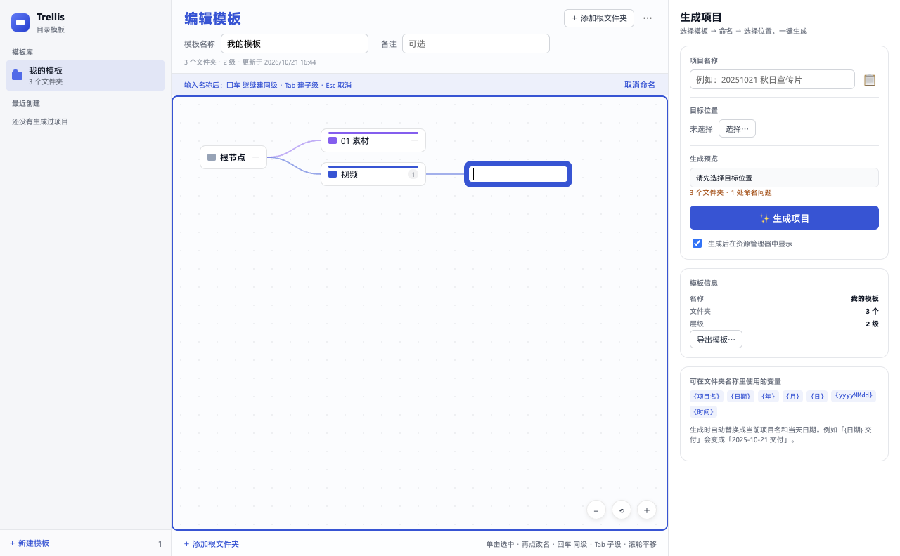

# Trellis for Windows

Trellis（目录模板）的 Windows 版本：把常用的项目目录结构保存成模板，选一个位置、给项目起个名字，一键生成整套项目文件夹。

技术栈：Electron + 原生 HTML/CSS/JS，安装包为 NSIS `.exe`，支持 Windows 10 / 11（x64）。



## 功能

- 模板库：新建、重命名、复制、删除、导入 / 导出 JSON
- 思维导图式编辑：根节点在左，分支向右展开，每个顶层分支一种颜色
- 键盘连续录入：
  - `回车`：保存当前名称，并立刻建下一个同级文件夹
  - `Tab`：保存当前名称，并在它下面建子级
  - `Esc`：取消当前输入，空文件夹自动移除
  - 单击立即选中，已选中的节点再点一次直接改名
- 画布激活后才接管 Tab / 回车，点击侧栏或右侧面板自动退出
- 变量：`{项目名}` `{日期}` `{yyyyMMdd}` `{时间}` `{年}` `{月}` `{日}`
- 生成前校验重名、非法字符、Windows 保留名（CON / PRN / AUX / NUL / COM1-9 / LPT1-9）
- 目标已存在同名文件夹时，可一键改用「项目 2」
- 最近创建：在资源管理器中显示、重命名文件夹（同步重命名磁盘目录）、从列表移除

## 数据位置

```
%APPDATA%\Trellis\library.json
```

模板只保存在本机，不联网。卸载应用不会删除模板库。

## 开发

```bash
pnpm install
pnpm start
```

## 打包 Windows 安装包

```bash
pnpm dist:win
# 或
npx electron-builder --win nsis --x64
```

产物：`release/Trellis-Setup-1.0.0.exe`

> 安装包未签名，Windows SmartScreen 可能提示“未知发布者”：
> 点「更多信息」→「仍要运行」即可。

## 目录结构

```
main.js             Electron 主进程（窗口、菜单、文件系统 IPC）
preload.js          contextBridge 暴露的窄接口
renderer/
  index.html        界面结构
  style.css         样式
  app.js            模板 / 导图 / 生成逻辑
build/icon.ico      Windows 图标
```
